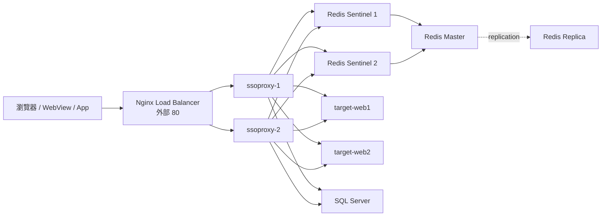

# SSO Proxy 系統設計文件

## 專案名稱：Webview 邊緣防禦與單一登入代理系統 (SSO Proxy)

---

## 1. 系統概述

本系統旨在提供一套非侵入式的邊緣防禦代理，將登入驗證、Token 管理、請求篩選與路由轉發集中在 Proxy 層，讓目標網站（Target Web）不必自行處理登入與身分驗證邏輯。

目前實作以 ASP.NET Core MVC + YARP Reverse Proxy 為核心，部署於 Docker Compose 多容器環境中，並搭配 Redis Sentinel 形成高可用快取層。該 Proxy 同時接管查詢、Header、Cookie、Form 的安全檢查，並在入口層統一攔截 SQL Injection、XSS 與其他可疑請求 payload。

### 核心設計哲學
- 強大邊緣，後端放手：安全防禦與驗證邏輯集中在 Proxy，目標應用保留純粹的業務邏輯。
- 無狀態化：Proxy 節點可水平擴展，雙活部署簡化擴容與故障轉移。
- 入口安全：透過 `SecurityFilterMiddleware` 先驗證請求，避免危險輸入進入 Controller / DAO / YARP。
- 風險隔離：Token 驗證、路徑白名單、Global Defense 與 reverse proxy 分層處理，降低攻擊面。

---

## 2. 系統架構

### 2.1 目前部署拓撲



### 2.2 請求處理流程

```text
UseStaticFiles
    -> SecurityFilterMiddleware
        -> GlobalDefenseMiddleware
            -> MVC Controller / API
            -> YARP Reverse Proxy
```

請求在進入業務邏輯之前，會先執行 `SecurityFilterMiddleware`，檢查下列來源：

- `Path`
- `QueryString`
- `Header`
- `Cookie`
- `Form`

檢查內容包含：

- SQL Injection payload
- XSS payload
- 不合法控制字元
- 明顯的 `OR 1=1`、`UNION SELECT`、`<script>`、`javascript:` 等惡意內容

若偵測到可疑輸入，Proxy 直接回覆 `400 Bad Request`，不再讓請求進入後續流程。

---

## 3. 技術選型與模組責任

### 3.1 技術堆疊
- 開發框架：ASP.NET Core MVC on .NET 10
- 反向代理：YARP
- 快取與 HA：Redis 7.2 + Redis Sentinel
- 資料庫：SQL Server 2022（PoC / 資料持久化預留）
- 容器基底：Alpine Linux / dotnet:10.0-alpine
- 測試框架：xUnit

### 3.2 主要元件

| 元件 | 實作位置 | 責任 |
| --- | --- | --- |
| Web Host / Pipeline | [ssoproxy/Program.cs](Program.cs) | 註冊 MVC、YARP、Redis、Service、全域 Middleware |
| 安全過濾器 | [ssoproxy/Middleware/SecurityFilterMiddleware.cs](Middleware/SecurityFilterMiddleware.cs) | 入口層掃描 Query、Header、Cookie、Form、Path，攔截 SQL Injection / XSS |
| 全域防禦 | [ssoproxy/Middleware/GlobalDefenseMiddleware.cs](Middleware/GlobalDefenseMiddleware.cs) | Token 驗證、路徑白名單、授權導向登入頁 |
| 路徑驗證 | [ssoproxy/Services/PathValidatorService.cs](Services/PathValidatorService.cs) | 處理登入與受保護路徑白名單 |
| 登入服務 | [ssoproxy/Services/Auth/LoginService.cs](Services/Auth/LoginService.cs) | 驗證帳密、產生登入結果與 Token |
| Token 服務 | [ssoproxy/Services/Auth/TokenService.cs](Services/Auth/TokenService.cs) | Token 建立、讀取與刪除 |
| DAO 範本 | [ssoproxy/Repository/DaoTemplate.cs](Repository/DaoTemplate.cs) | 依資料庫抽象方式包裝參數與 SQL 執行 |
| SQL 防護 | [ssoproxy/Repository/SqlInjectionGuard.cs](Repository/SqlInjectionGuard.cs) | SQL Injection 檢測與安全參數清理 |
| YARP 代理 | [ssoproxy/appsettings.json](appsettings.json) | Host-based routing 至 target-web1 / target-web2 |

---

## 4. 安全設計

### 4.1 SecurityFilterMiddleware

`SecurityFilterMiddleware` 是目前的統一入口安全屏障，目的在於把橫跨多個 API / MVC / 路由的危險請求集中處理，避免安全檢查散落在 DAO、Controller 或未統一邏輯中。

它目前會處理以下項目：

1. `Path` 檢查
   - 例如 `/health`、`/login`、`/api/*` 等路徑，如果帶有惡意字串，直接拒絕。

2. `QueryString` 檢查
   - 檢查 `?q=...`、`?redirect=...` 等引數是否包含 SQL 或 XSS 攻擊語法。

3. `Header` 檢查
   - 會檢查 `Accept`、`User-Agent`、`Authorization` 等 Header 值。
   - 這裡特別避免將正常 HTTP Header 值（如 `text/html, */*`）誤判為 SQL 注入。

4. `Cookie` 檢查
   - 檢查登入 Cookie 或其他可疑 cookie 是否帶有惡意 payload。

5. `Form` 檢查
   - 包含登入表單、提交內容、JSON-form payload 等表單內容一併檢查。

### 4.2 SQL Injection 保護

`SqlInjectionGuard` 會檢查：

- `OR 1=1`
- `UNION SELECT`
- `DROP TABLE`
- `DELETE FROM`
- `WAITFOR`、`DECLARE`、`EXEC`
- 惡意註解 `--`、`/* */`
- 邊界條件與控制字元

並在 DAO / parameterized query 使用前做安全清理，降低直接注入資料庫的風險。

### 4.3 XSS 保護

XSS 檢查目前也已整合進 `SqlInjectionGuard.IsRequestValueSuspicious`，會檢查：

- `<script>`
- ``
- `javascript:`
- `vbscript:`
- `onload=` 等事件型攻擊向量

這使 Proxy 不會將這些惡意內容放進後續處理流程。

---

## 5. 啟動與執行

```bash
docker compose up -d --build
docker compose ps
docker compose logs -f sso-poc-proxy1
```

對外網路入口為 `http://localhost`，內部由 Nginx 分流至雙 Proxy。

### 5.1 Host-based 路由設定

若要使用 Host-based YARP 路由，需在本機 host 檔加入：

```text
127.0.0.1 test1.gd.com test2.gd.com
```

### 5.2 登入與測試範例

```bash
curl -X POST http://test1.gd.com/api/Token \
  -H 'Content-Type: application/json' \
  -d '{"username":"admin","password":"admin123"}'
```

登入後可測試：

```bash
curl -H 'Host: test1.gd.com' --cookie 'sso_token=<token>' http://127.0.0.1/targetpage.html
curl -H 'Host: test2.gd.com' --cookie 'sso_token=<token>' http://127.0.0.1/index.html
```

---

## 6. Docker Compose 設定

### 6.1 服務角色

| Service | 角色 | 備註 |
| --- | --- | --- |
| `sso-poc-nginx` | 對外唯一入口 | Nginx Load Balancer |
| `sso-poc-proxy1` / `sso-poc-proxy2` | Proxy 雙節點 | healthcheck / active-active |
| `sso-poc-redis-master` | Redis 主節點 | 寫入 Token 狀態 |
| `sso-poc-redis-slave` | Redis 從節點 | 自動同步 |
| `sso-poc-sentinel1` / `sso-poc-sentinel2` | Redis Sentinel | 故障轉移監控 |
| `sso-poc-mssql2022` | SQL Server | 資料持久化/DAO 預留 |
| `sso-poc-target-web1` / `sso-poc-target-web2` | 受保護網站 | 模擬 target web |

---

## 7. 注意事項與限制

- `LoginService` 目前仍使用固定測試帳密；正式環境建議改接實際身分驗證後端。
- `GlobalDefenseMiddleware` 負責驗證 Token 與路徑放行；`SecurityFilterMiddleware` 負責攻擊 payload 押制。
- 安全過濾器會拒絕明顯惡意內容，但不可過度寬鬆；合法 HTTP Headers 如 `Accept: text/html, */*` 應被視為正常值。
- `Jwe:Secret`、Redis 密碼與資料庫設定目前仍存在範例設定中，正式環境應改由 Secret Management 管理。
- Docker Compose 的 `healthcheck` 會監控 `/health` 端點，保證 proxy 已就緒再啟動上游 Nginx。

---

## 8. 文件版本

- 版本：v2.0.0
- 更新日期：2026-11-13
- 狀態：已同步實作現況，包含 `SecurityFilterMiddleware`、XSS / SQL 防護與 .NET 10 執行環境。